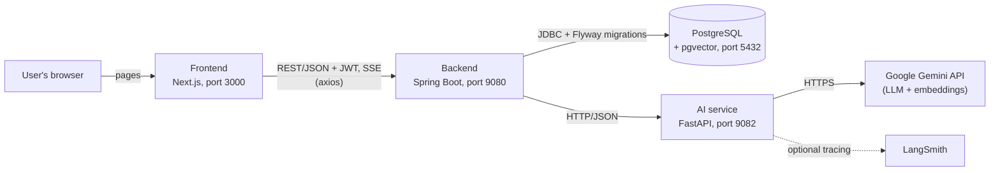

# LinQOrbit

LinQOrbit is a prototype of an AI-assisted recruitment platform. Candidates and recruiters work on
**normalized profiles and job offers**, and the platform compares them criterion by criterion with
a large language model (LLM), showing every score and its justification instead of a single opaque
verdict. The final hiring decision always stays with the recruiter.

> **Status: prototype / university project.** The application runs locally and covers the main
> candidate, recruiter and admin workflows described below. It has not been hardened, audited for
> security or load-tested for production use (see [Current project status](#c-current-project-status)
> and [Security notes](#k-security-notes)).

**Language note:** the user interface and the code are in English, but the project's internal
documents (`SPEC_PRODUIT.md`, `TECH_DEBT.md`, `docs/tasks.md` and the `AGENTS.md` files) are written
in French.

## Table of contents

- [A. Project overview](#a-project-overview)
- [B. Key features](#b-key-features)
- [C. Current project status](#c-current-project-status)
- [D. Technology stack](#d-technology-stack)
- [E. Architecture](#e-architecture)
- [F. Prerequisites](#f-prerequisites)
- [G. Local installation and setup](#g-local-installation-and-setup)
- [H. Environment variables and secrets](#h-environment-variables-and-secrets)
- [I. Running tests and development commands](#i-running-tests-and-development-commands)
- [J. Troubleshooting](#j-troubleshooting)
- [K. Security notes](#k-security-notes)
- [L. License and contributions](#l-license-and-contributions)

---

## A. Project overview

**The problem.** Job offers and CVs are free text. Recruiters spend time reading dozens of
applications that are written differently, and candidates rarely learn how their profile was
interpreted.

**The approach.** LinQOrbit turns both sides into a common, structured format and compares them:

1. A candidate's profile (or an imported CV) and a recruiter's job offer are each **normalized by an
   LLM** into a canonical, versioned JSON "sheet".
2. The **matching engine** scores the candidate against each criterion extracted from the offer
   (required skills, preferred skills, languages, experience, education) and keeps the justification.
3. **Dynamic Candidate Assessment (DCA)**: where the information is uncertain, the AI asks the
   candidate a few targeted questions and re-evaluates the affected criteria.
4. The candidate can see how each criterion was scored and contest it with their own score and
   comment. This never changes the AI score.
5. Embedding-based **screening** can suggest likely candidates to a recruiter when an offer is
   published, for candidates who have consented to be visible to recruiters.

Guiding principles taken from the product specification: the AI provides verifiable observations,
not hiring decisions; the candidate sees how they were assessed; matching is based on normalized
sheets rather than raw text.

**Intended users.** Candidates, recruiters (members of a company) and platform administrators.

**Current implementation vs. long-term vision.** This repository implements the workflows listed in
[Key features](#b-key-features). The specification (`SPEC_PRODUIT.md`) also describes later phases
(advanced matching, freelance support, market intelligence, an external API) that are **not**
implemented.

## B. Key features

Everything below exists in the current codebase. The Swagger UI of the running backend lists the
corresponding endpoints.

**Accounts and identities**
- Sign-up, login (JWT), change password. One account can hold a candidate profile and/or a recruiter
  profile; an `ADMIN` role gives access to the admin console.

**Candidate side**
- Structured profile: about, experiences, projects, diplomas, skills, languages, links; PDF CV upload
  and management.
- AI import of a CV into the profile.
- Explicit **profile validation** that triggers an asynchronous AI normalization (versioned sheets,
  status pushed to the browser via Server-Sent Events).
- Job board (public), job detail, **application flow** (draft, answers to the recruiter's
  questions, matching, submit, withdraw) and "my applications".
- **Matching transparency**: per-criterion scores, **DCA** questions (answer or skip, one at a time,
  re-evaluation after each answer), and per-criterion contestation with a score and a comment.
- Opt-in **consent to recruiter visibility** and a list of invitations to apply.
- Candidate dashboard.

**Recruiter side**
- Companies, recruiter profile, job offers with a lifecycle (draft, validated, published, closed),
  rich-text description, structured requirements, pre-screening questions, and a configurable
  maximum number of DCA questions (0–10, default 3).
- AI analysis (normalization) of each offer.
- Applications per offer: sorting by section score or by number of contested criteria, full detail
  (answers, per-criterion scores and justifications, contestations, CV), manual accept / reject
  decisions, and an internal "report this AI evaluation" action.
- **Suggested candidates**: when an offer is published, a vector search (embeddings + pgvector)
  proposes the top N consenting candidates; the recruiter can open the full profile and invite them.
- Recruiter dashboard and offer search/filters.

**Admin side**
- Dashboard, account list (search and filters), global offer list (search and filters), account and
  offer detail, viewer for normalized sheets with version history, review of skill suggestions, and
  review of AI-evaluation reports (one final review per admin).

**What the AI service does** (`ai-service/`): CV parsing, profile and job-offer normalization,
matching analysis per criterion, DCA question generation, and text embeddings.

## C. Current project status

| Area | State |
|---|---|
| Implemented | The features listed in section B, with automated tests in all three code bases. |
| Prototype limits | The matching score uses a **provisional weighting scheme**; screening parameters (such as the size of the top N) are experimental; the screening recall was only measured against synthetic seed data. |
| Work in progress / future | Items of the specification's later phases: advanced matching and statistics, freelance support, market intelligence, external API. Known technical debt is tracked in [`TECH_DEBT.md`](TECH_DEBT.md); task history in [`docs/tasks.md`](docs/tasks.md). |
| Not provided | Production deployment configuration, CI configuration, a license (see section L). |

No users, customers, revenue, performance benchmarks or production usage are claimed.

## D. Technology stack

Versions are read from the manifests of the repository (`pom.xml`, `package.json`, `pyproject.toml`
and lock files).

| Layer | Technology | Role |
|---|---|---|
| Frontend | Next.js 16.3.7 (App Router), React 19.2.8, TypeScript 5 | Web application (candidate, recruiter, admin, public pages) |
| | Tailwind CSS 4 | Styling |
| | TanStack Query 5, Zustand 5, axios | Server state, UI state, HTTP client |
| | react-hook-form 7, Zod 4, Tiptap 3, DOMPurify | Forms, validation, rich-text offer editor, HTML sanitizing |
| Backend | Java 17, Spring Boot 4.1.1, Maven (wrapper, Maven 3.9.16) | Main API: all business logic, data ownership, orchestration of the AI service |
| | Spring Web MVC, Spring Security (OAuth2 resource server, HS256 JWT), Bean Validation | REST API and authentication |
| | Spring Data JPA / Hibernate, Flyway | Persistence and SQL migrations |
| | MapStruct 1.6.3, Lombok, jsoup | Mapping, boilerplate reduction, HTML sanitizing |
| | springdoc-openapi 3.1.1 | OpenAPI and Swagger UI |
| AI service | Python ≥ 3.12, FastAPI 0.142.1, Uvicorn | Stateless HTTP service for AI tasks |
| | LangChain 1.4.3, LangGraph 1.2.12, langchain-google-genai 4.4.0 | Agents and Gemini access |
| | pypdf, Pydantic (pydantic-settings) | PDF text extraction, API contracts and settings |
| | uv | Dependency management (`pyproject.toml` + `uv.lock`) |
| Database | PostgreSQL (developed against 17.x) with the **pgvector** extension (0.8.x) and **pg_trgm** | Relational data, JSONB sheets, embedding vectors (`vector(1536)`) |
| External | Google Gemini API (default LLM `gemini-3.1-flash-lite`, embeddings `gemini-embedding-2`) | LLM and embedding provider, called only by the AI service |
| Optional external | LangSmith | Tracing of agent runs (can be disabled) |
| Testing | JUnit 5, Mockito, AssertJ, Spring Test (backend); Vitest 5, Testing Library, jsdom (frontend); pytest, httpx (AI service) | Automated tests |
| Linting | ESLint 9 with `eslint-config-next` (frontend) | Static analysis |

## E. Architecture



- **Frontend** only talks to the backend (`NEXT_PUBLIC_API_URL`, default `http://localhost:9080`).
  It never calls the AI service.
- **Backend** owns every business rule and all data. It stores profiles, offers, applications,
  matchings, embeddings and CV files, and it calls the AI service over HTTP. Long-running AI work
  (normalization, matching, embeddings, candidate screening) runs in **durable background jobs
  stored in PostgreSQL** and executed by in-process workers; progress is pushed to the browser with
  Server-Sent Events. There is no message broker.
- **AI service** is stateless: the backend sends the whole context on each call, and the service
  keeps no data. It is the only component that calls Google Gemini.
- **Database**: schema managed exclusively by Flyway migrations
  (`backend/src/main/resources/db/migration`, V1 to V33). Hibernate only validates the schema.
- **CV files** are stored on the backend's local disk (`APP_ATTACHMENTS_ROOT`), not in the database.

### Repository layout

| Path | Content |
|---|---|
| `frontend/` | Next.js application (`app/` routes, `features/`, `components/`, `hooks/`, `lib/api/`, `tests/`) |
| `backend/` | Spring Boot application, organized by domain (`auth`, `candidate`, `joboffer`, `application`, `matching`, `embedding`, `screening`, `invitation`, `admin`, …) and Flyway migrations |
| `ai-service/` | FastAPI application (`app/api`, `app/agents`, `app/graphs`, `app/llm`, `app/schemas`) and `tests/` |
| `scripts/seed/` | Deterministic **synthetic** seed-data generator and generated `seed.sql` / `cleanup.sql` |
| `docs/` | Task board (`tasks.md`, in French) |
| `SPEC_PRODUIT.md` | Product specification and decision log (French) |
| `TECH_DEBT.md` | Known technical debt (French) |
| `AGENTS.md`, `*/AGENTS.md` | Coding conventions per component (French) |

## F. Prerequisites

| Tool | Version | Required? | Why |
|---|---|---|---|
| Git | any recent | Mandatory | Clone the repository |
| JDK | **17** (the version the project targets; newer JDKs were not tested) | Mandatory | Build and run the backend. Maven is **not** needed: the Maven Wrapper (`mvnw` / `mvnw.cmd`) downloads Maven 3.9.16 on first use |
| Node.js + npm | Node **≥ 20.9** (Next.js requirement; the project was run with Node 24) | Mandatory | Frontend |
| Python | **≥ 3.12** | Mandatory | AI service |
| [uv](https://docs.astral.sh/uv/) | recent | Strongly recommended | Installs the locked Python dependencies and runs the AI service. Without it, create a virtual environment and install the dependencies listed in `ai-service/pyproject.toml` yourself |
| PostgreSQL 17 with **pgvector** | 17.x tested; pgvector 0.8.x | Mandatory | Database. Easiest option: the official `pgvector/pgvector:pg17` Docker image — its tag follows the **latest** pgvector release, not a pinned version. The version pinned by this repository is **pgvector 0.8.7** (local image `linqorbit-postgres:17-pgvector`, D57) |
| Docker | recent | Optional | Only used here to run PostgreSQL. You may install PostgreSQL and pgvector natively instead |
| Google AI Studio API key | – | Required for AI features | Used by the AI service for the LLM and embeddings. The application starts without it, but every AI-backed action fails ([how to get a key](https://aistudio.google.com/apikey)) |
| LangSmith API key | – | Optional | Only for tracing agent runs |

The database user must be allowed to run `CREATE EXTENSION vector` (pgvector is **not** a "trusted"
extension, so this requires a superuser) when the first migration that needs it (V28) runs. The
Docker command below creates such a user. `pg_trgm` is trusted and needs no special privilege.

Windows note: use `mvnw.cmd` (PowerShell: `.\mvnw.cmd ...`) instead of `./mvnw`. The examples use
bash syntax (Git Bash, macOS, Linux); PowerShell equivalents are given where the syntax differs.

## G. Local installation and setup

The default ports are **5432** (PostgreSQL), **9080** (backend), **9082** (AI service) and **3000**
(frontend). Once the setup steps are done, open **three terminals** (backend, AI service, frontend).

### 1. Clone the repository

```bash
git clone https://github.com/medkaidi/LinQOrbit.git
cd LinQOrbit
```

(The remote recorded in the repository is `git@github.com:medkaidi/LinQOrbit.git`; adapt the URL if
you use a fork.)

### 2. Start the database

Run from anywhere. This creates a PostgreSQL 17 server with pgvector, a `linqorbit` database and a
`linqorbit` superuser, matching the backend defaults:

```bash
docker run -d --name linqorbit-pg \
  -e POSTGRES_USER=linqorbit -e POSTGRES_PASSWORD=linqorbit -e POSTGRES_DB=linqorbit \
  -p 5432:5432 pgvector/pgvector:pg17
```

(PowerShell: put the command on one line or use backtick `` ` `` instead of `\`.) Add
`-v linqorbit-pgdata:/var/lib/postgresql/data` to keep the data when the container is removed.

The container is named **`linqorbit-pg`** — the name used throughout this repository
(`backend/AGENTS.md`, `docs/tasks.md`). If a container with another name already runs on port 5432,
stop or rename it first: two PostgreSQL servers cannot share the port.

**Using the image pinned by this repository instead:** the official `pgvector/pgvector:pg17` tag
follows the latest pgvector release. The version this repository is developed and tested against is
**pgvector 0.8.7**, carried by the local image `linqorbit-postgres:17-pgvector` (D57, documented in
`backend/.env.example`) — substitute it in the command above if you want the exact same extension
version.

Check it is ready:

```bash
docker exec linqorbit-pg pg_isready -U linqorbit -d linqorbit
```

**Using a native PostgreSQL instead:** install PostgreSQL 17 and the pgvector extension, create a
database and a user, and have a superuser run `CREATE EXTENSION IF NOT EXISTS vector;` in that
database before starting the backend. Then set the `DB_*` variables (section H).

No manual schema step is needed: **Flyway applies the 33 migrations automatically when the backend
starts**, including `CREATE EXTENSION vector` (V28) and `CREATE EXTENSION pg_trgm` (V32).

### 3. Configure the AI service (`ai-service/.env`)

```bash
cd ai-service
cp .env.example .env        # PowerShell: Copy-Item .env.example .env
```

Edit `ai-service/.env`:

- Set `GOOGLE_API_KEY` to your Gemini API key (never commit it).
- Set `LANGSMITH_TRACING=false` unless you have a LangSmith key (the example file enables tracing by
  default); otherwise also fill `LANGSMITH_API_KEY`.

The AI service reads `.env` from the `ai-service/` directory, so always start it from there.

### 4. Configure the backend (optional)

The backend reads **process environment variables**. Every variable has a default in
`backend/src/main/resources/application.yml` that matches the database command above, so **no
configuration is required for a default local setup**.

> `backend/.env.example` says to copy it to `.env`, but the backend does **not** load a `.env` file
> by itself (no `.env` loader is configured). Export the variables in the shell that starts the
> backend, or load the file with your IDE or shell. See section H for the list.

### 5. Configure the frontend (optional)

The frontend uses `http://localhost:9080` by default. To point it elsewhere, create
`frontend/.env.local` (git-ignored; there is no `.env.example` for the frontend):

```bash
NEXT_PUBLIC_API_URL=http://localhost:9080
```

### 6. Install dependencies

```bash
# AI service (from ai-service/): creates .venv from uv.lock
cd ai-service && uv sync

# Frontend (from frontend/)
cd ../frontend && npm install
```

The backend dependencies are downloaded by Maven on first run.

### 7. Start the services (one terminal each, in this order)

**Terminal 1: backend**: from `backend/`. The first start applies the migrations.

```bash
cd backend
./mvnw spring-boot:run          # Windows PowerShell: .\mvnw.cmd spring-boot:run
```

Wait for the log line `Started LinQOrbitApplication`.

**Terminal 2: AI service**: from `ai-service/`.

```bash
cd ai-service
uv run uvicorn app.main:app --reload --port 9082
```

The AI service is called by the backend when AI work runs (CV import, normalization, matching, DCA
questions, embeddings), so start it before using those features.

**Terminal 3: frontend**: from `frontend/`.

```bash
cd frontend
npm run dev
```

### 8. Open the application and verify

| What | URL |
|---|---|
| Web application | http://localhost:3000 (login: `/login`, sign-up: `/signup`, public job board: `/jobs`) |
| Backend Swagger UI | http://localhost:9080/swagger-ui.html |
| Backend OpenAPI document | http://localhost:9080/v3/api-docs |
| AI service health | http://localhost:9082/health (returns `{"status":"ok"}`) |
| AI service API docs | http://localhost:9082/docs |

The backend has **no dedicated health endpoint** (no Spring Actuator). Quick checks:

```bash
curl -i http://localhost:9080/v3/api-docs        # 200: backend up, schema validated, DB reachable
curl    http://localhost:9080/api/v1/jobs        # {"items":[],"page":0,"size":20,"total":0} on an empty database
curl    http://localhost:9082/health             # {"status":"ok"}
```

On a fresh database, a default administrator is created at startup (see section H); you can log in
with it, or sign up from the UI.

### 9. Optional: load synthetic demo data

`scripts/seed/seed.sql` contains about 100 **synthetic** candidates, 15 recruiters and 100 job
offers (including already-normalized profiles, so no LLM call is needed to browse them). Load it
**after the backend has started once** (so that Flyway has created the schema). From the repository
root, with the container from step 2:

```bash
docker exec -i linqorbit-pg psql -U linqorbit -d linqorbit -v ON_ERROR_STOP=1 -q < scripts/seed/seed.sql
```

(PowerShell does not support `<`; use `Get-Content -Raw scripts/seed/seed.sql | docker exec -i linqorbit-pg psql -U linqorbit -d linqorbit -v ON_ERROR_STOP=1 -q`. This variant was not tested.)

All seeded accounts use the password `seed1234` and an e-mail ending in `@seed.linqorbit.dev`,
for example `recruiter0@seed.linqorbit.dev` (recruiters are `recruiter0` to `recruiter14`). List
candidate e-mails with:

```bash
docker exec linqorbit-pg psql -U linqorbit -d linqorbit -At -c "select u.email from users u join candidates c on c.id = u.id order by 1 limit 5"
```

The seeds do not contain embedding vectors. To make seeded profiles searchable by the screening
feature, start the backend with `EMBEDDING_BACKFILL_ON_BOOT=true` and a working AI service (this
calls the Gemini embeddings API for every current sheet, so mind your quota). Details:
[`scripts/seed/results/README.md`](scripts/seed/results/README.md). To remove the seeds:
`python scripts/seed/generate.py --down > cleanup.sql` and run it the same way (on Windows set
`PYTHONIOENCODING=utf-8` first); the generator's options are described at the top of
`scripts/seed/generate.py`. Do not run the seeds against a database that holds data you care about.

### What was verified, and what was not

This guide was partly validated on a Windows machine (Windows 11, JDK 17, Node 24, Python 3.12,
Docker with the `pgvector/pgvector:pg17` image): on a **new, empty** PostgreSQL container, the
backend applied the 33 migrations and started, the default administrator could log in, `seed.sql`
loaded, a seeded recruiter and a seeded candidate could log in, and the AI service started and
answered `/health`. The frontend production build and the three test suites were also run (section
I). **Not verified:** a clean-machine installation of every tool, macOS and Linux, the native
PostgreSQL route, the PowerShell variants marked above, and any end-to-end AI behavior (CV import,
normalization, matching, DCA, embeddings), which requires a real Gemini API key.

## H. Environment variables and secrets

Use placeholders only; never commit real values. `.env` files are git-ignored in each component
(see [Security notes](#k-security-notes)).

### Backend (process environment; defaults in `backend/src/main/resources/application.yml`)

| Variable | Default | Purpose | Required? |
|---|---|---|---|
| `DB_HOST`, `DB_PORT`, `DB_NAME` | `localhost`, `5432`, `linqorbit` | PostgreSQL location | Only if different |
| `DB_USERNAME`, `DB_PASSWORD` | `linqorbit`, `linqorbit` | Database credentials | Only if different |
| `APP_JWT_SECRET` | built-in development value | Signing key of the JWT tokens (HS256, at least 32 characters) | **Set your own for anything but throwaway local use** |
| `APP_JWT_TTL_SECONDS` | `86400` | Token lifetime | No |
| `ADMIN_EMAIL`, `ADMIN_PASSWORD` | built-in development values | Administrator account created at startup if no `ADMIN` exists | **Set your own for anything but throwaway local use** |
| `CORS_ALLOWED_ORIGINS` | `http://localhost:3000,http://localhost:3100` | Allowed browser origins (comma-separated) | If the frontend runs elsewhere |
| `AI_SERVICE_BASE_URL` | `http://localhost:9082` | Where the backend finds the AI service | If it runs elsewhere |
| `AI_CONNECT_TIMEOUT_MS`, `AI_READ_TIMEOUT_MS` | `5000`, `120000` | Timeouts of AI calls | No |
| `SERVER_PORT` | `9080` | HTTP port (standard Spring Boot override) | No |
| `APP_ATTACHMENTS_ROOT` | `./data/attachments` | Directory for uploaded CVs (relative to the backend working directory, git-ignored) | No |
| `EMBEDDING_MODEL_NAME`, `EMBEDDING_MODEL_VERSION` | `gemini-embedding-2`, `1` | Active embedding model; must match `EMBEDDING_MODEL` of the AI service (checked on every response) | Only if you change the model |
| `EMBEDDING_BACKFILL_ON_BOOT` | `false` | Vectorize all current sheets at startup (calls the provider; leave off unless needed) | No |
| `EMBEDDING_RECOVERY_ON_BOOT` | `true` | Resume unfinished embedding jobs at startup | No |
| `SCREENING_TOP_N` | `10` | Number of suggested candidates per offer (experimental; capped at 500) | No |
| `NORMALIZATION_THREADS`, `MATCHING_THREADS`, `EMBEDDING_THREADS`, `SCREENING_THREADS` and the related `*_RETRY_DELAY_SECONDS`, `EMBEDDING_MIN_INTERVAL_MS`, `EMBEDDING_QUOTA_RETRY_DELAY_SECONDS`, `EMBEDDING_BACKFILL_BATCH_SIZE` | see `application.yml` | Worker pools, retry delays and rate limiting | No |

The default JWT secret and administrator credentials are public in this repository: anyone who
knows them can forge tokens or log in as administrator on an instance that still uses them.

### AI service (`ai-service/.env`, see `ai-service/.env.example`)

| Variable | Default | Purpose | Required? |
|---|---|---|---|
| `GOOGLE_API_KEY` | empty | Gemini API key (LLM and embeddings), from Google AI Studio | **Yes, for AI features** |
| `LLM_MODEL` | `gemini-3.1-flash-lite` | LLM used by the agents | No |
| `LLM_TIMEOUT_SECONDS`, `LLM_MAX_RETRIES` | `120`, `2` | Bounds on each LLM call | No |
| `EMBEDDING_MODEL`, `EMBEDDING_DIMENSIONS` | `gemini-embedding-2`, `1536` | Embedding model and size; the database column is `vector(1536)`, so keep `1536` | No |
| `LOG_LEVEL` | `INFO` | Console log level | No |
| `LANGSMITH_TRACING`, `LANGSMITH_API_KEY`, `LANGCHAIN_PROJECT`, `LANGSMITH_ENDPOINT` | tracing `true` in the example, no key | LangSmith tracing | Optional (set tracing to `false` without a key) |
| `TAVILY_API_KEY` | commented out in the example | Reserved for a future web-search tool; unused by the current features | No |

### Frontend (`frontend/.env.local`)

| Variable | Default | Purpose | Required? |
|---|---|---|---|
| `NEXT_PUBLIC_API_URL` | `http://localhost:9080` | Backend base URL, embedded in the browser bundle (so never put a secret in it) | Only if the backend runs elsewhere |

Setting a variable for one session: bash `export ADMIN_PASSWORD='change-me'`; PowerShell
`$env:ADMIN_PASSWORD = 'change-me'`.

## I. Running tests and development commands

| Component | Directory | Command | Notes |
|---|---|---|---|
| Backend: run | `backend/` | `./mvnw spring-boot:run` | Needs the database |
| Backend: tests | `backend/` | `./mvnw clean test` | Always use `clean`. About 3–4 minutes |
| Backend: full check | `backend/` | `./mvnw verify` | Listed in the project conventions (`backend/AGENTS.md`); not run for this README |
| AI service: run | `ai-service/` | `uv run uvicorn app.main:app --reload --port 9082` | |
| AI service: tests | `ai-service/` | `uv run pytest` | No LLM call, no database |
| Frontend: run | `frontend/` | `npm run dev` | |
| Frontend: tests | `frontend/` | `npm run test:run` (watch mode: `npm test`) | No backend needed |
| Frontend: lint | `frontend/` | `npm run lint` | ESLint |
| Frontend: type-check | `frontend/` | `npx tsc --noEmit` | |
| Frontend: build / serve | `frontend/` | `npm run build`, then `npm run start` | |

**Backend test caveats.** The integration tests use a **real PostgreSQL** (with pgvector) configured
through the same `DB_*` variables as the application, create their own fixture rows and delete them
afterwards. Run them against a disposable database, **never** against one with data you need. The
suite keeps many Spring contexts open, each with a small connection pool: if you see "too many
clients already", raise `max_connections` of your PostgreSQL server. If a context fails with
`No qualifying bean of type 'long'`, rebuild with `./mvnw clean test` (stale Lombok annotation
processing). Some opt-in tests and scripts (live LLM tests such as
`RUN_LLM_TESTS=1 uv run pytest tests/test_cv_agent_live.py`, the matching "golden set" scripts in
`ai-service/scripts/`, the screening recall report) call the real LLM or need seeded data and are
**not** part of the default runs.

**Results observed while preparing this README** (2026-10-26, Windows, JDK 17, Node 24, Python 3.12;
the counts will change as the project evolves):

| Check | Result |
|---|---|
| `./mvnw clean test` (backend) | 1204 tests, 0 failures, 0 errors, 0 skipped |
| `npm run test:run` (frontend) | 146 files, 1446 tests passed |
| `npm run lint`, `npx tsc --noEmit` (frontend) | no error |
| `npm run build` (frontend) | succeeded |
| AI service `pytest` | 512 passed, 1 skipped (the live-LLM test) |

There is no CI configuration in the repository.

## J. Troubleshooting

| Problem | What to check |
|---|---|
| Backend cannot connect to the database | Is the container running (`docker ps`) and ready (`docker exec linqorbit-pg pg_isready -U linqorbit -d linqorbit`)? Do `DB_HOST`, `DB_PORT`, `DB_NAME`, `DB_USERNAME` and `DB_PASSWORD` match the database? Is another PostgreSQL already listening on 5432? |
| Startup fails around migration V28 (`vector` extension) | The server must have pgvector installed and the database user must be a superuser (or a superuser must run `CREATE EXTENSION vector;` first). The `pgvector/pgvector:pg17` image with `POSTGRES_USER=linqorbit` satisfies both. |
| Startup fails with a schema validation error | The backend validates the schema against the entities. Use a database created only by this repository's migrations. Migrations are immutable: never edit an applied one. |
| Port already in use (3000, 5432, 9080, 9082) | Stop the other process, or change the port: backend `SERVER_PORT`, AI service `--port`, frontend `npm run dev -- -p <port>`. Then update `NEXT_PUBLIC_API_URL`, `AI_SERVICE_BASE_URL` and `CORS_ALLOWED_ORIGINS` accordingly. |
| Browser errors on API calls (CORS) | The frontend origin must be listed in `CORS_ALLOWED_ORIGINS` (defaults: ports 3000 and 3100). |
| Frontend shows network errors | Is the backend running at `NEXT_PUBLIC_API_URL`? This variable is read at build/start time: restart `npm run dev` after changing `.env.local`. |
| Compilation or class-version errors in the backend | Wrong JDK. Check `java -version` (17 expected). |
| Frontend install or start errors | Check `node --version` (≥ 20.9). Delete `frontend/node_modules` and run `npm install` again. |
| `uv` not found, or wrong Python | Install uv and Python ≥ 3.12; run `uv sync` from `ai-service/`. |
| AI features fail or never finish | Check `curl http://localhost:9082/health`, then `AI_SERVICE_BASE_URL`, then `GOOGLE_API_KEY`. Background jobs retry (3 executions in total for normalization) and then end in a failed state, visible in the UI; the backend and AI-service logs share a request id (`X-Request-Id`). |
| Embedding or screening problems | `EMBEDDING_MODEL_NAME` (backend) must equal `EMBEDDING_MODEL` (AI service): a mismatching response is rejected. A provider quota error (HTTP 429) delays retries. |
| `PYTHONIOENCODING` / unreadable characters when generating seeds on Windows | Set `PYTHONIOENCODING=utf-8` before running `scripts/seed/generate.py`. |
| Uploaded CVs missing after changing directory | `APP_ATTACHMENTS_ROOT` defaults to a path relative to the backend working directory; start the backend from `backend/` or set an absolute path. |

## K. Security notes

- **Never commit secrets or `.env` files.** Use local development credentials and a personal
  Gemini key; revoke any key that was ever committed or pasted somewhere public.
- **Do not use real candidate data** for testing unless you have the authorization and safeguards
  to process it. The platform handles CVs, contact details and professional histories; uploaded
  CVs are stored as plain files on the backend's disk (no encryption is implemented in the code),
  and profile contents are sent to the Gemini API by the AI service.
- **Defaults are for local development only.** The repository contains a default JWT signing secret,
  a default administrator account and default database credentials (`application.yml`,
  `.env.example`). Override all of them for any shared or exposed instance. The seed accounts all
  share the public password `seed1234`.
- **The AI service has no authentication.** Anyone who can reach port 9082 can use your Gemini
  quota. Keep it on `localhost` or a private network.
- **Route protection is explicit, with a permissive fallback.** The backend's security
  configuration ends with `anyRequest().permitAll()`, so every new route root must be listed
  explicitly as authenticated (tracked in `TECH_DEBT.md`, TD-037).
- This is a prototype: no production-readiness, penetration test or security audit is claimed.

## L. License and contributions

**No license file is present in the repository, and none is declared.** Until the owner adds one,
default copyright applies: viewing is possible, but reuse, modification and redistribution are not
granted.

There is no contribution policy. The coding conventions of each component are written in
[`AGENTS.md`](AGENTS.md), [`backend/AGENTS.md`](backend/AGENTS.md),
[`frontend/AGENTS.md`](frontend/AGENTS.md) and [`ai-service/AGENTS.md`](ai-service/AGENTS.md)
(in French). The project rule is that a feature is not finished without its tests, and that every
fixed bug comes with a regression test.
